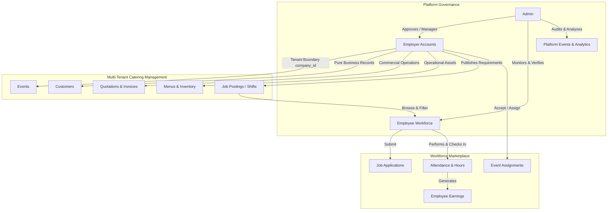
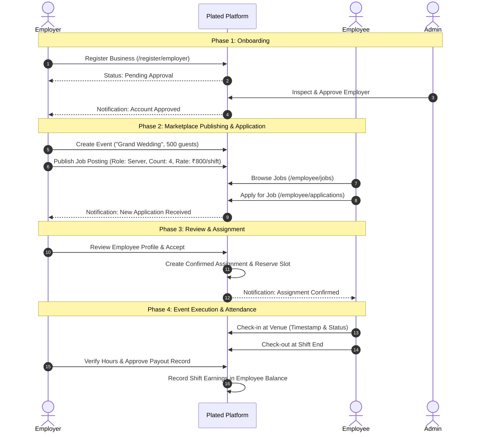

# Phase 2: Target Architecture Specification

**Project:** Plated — Multi-Tenant Catering Business Management & Workforce Marketplace  
**Date:** November 19, 2026  
**Document Version:** 1.0.0  
**Target Architecture:** Strict 3-Role Architecture (`admin`, `employer`, `employee`)

---

## 1. System Vision & Architecture Principles

The restructured Plated platform operates on two interconnected pillars:
1. **Multi-Tenant Catering Business Management (SaaS):** Catering businesses (**Employers**) manage their independent business operations (events, customers, quotations, invoices, menus, inventory, reports) with strict tenant isolation.
2. **Workforce Marketplace Platform:** Freelancers, students, and catering workers (**Employees**) independently register, discover event staffing requirements across multiple catering businesses, apply for shifts, check in/out, and track event earnings.
3. **Platform Governance:** The platform owner (**Admin**) reviews and approves catering businesses, monitors platform events, oversees the workforce marketplace, and tracks platform analytics.



---

## 2. The Strict Three Roles

There are **EXACTLY THREE ROLES** across the entire platform. No sub-roles, no global role variants, and no external client logins.

| Role Name | Platform Key | Target Audience | Primary Access Portal | Public Registration URL | Login URL |
|---|---|---|---|---|---|
| **Admin** | `admin` | Platform Owners & Superusers | `/admin/*` | *None (Provisioned by CLI/Seed)* | `/admin` |
| **Employer** | `employer` | Catering Business Owners | `/employer/*` | `/register/employer` | `/employer/login` |
| **Employee** | `employee` | Freelance & Temporary Catering Workers | `/employee/*` | `/register/employee` | `/employee/login` |

### 2.1 Role 1: Admin
- **Authentication:** Isolated `/admin` login page. No public registration. Credentials provisioned securely via database seeds or administrative CLI.
- **Capabilities:**
  - Full visibility across all tenants (unrestricted by company boundaries).
  - Employer registration approval pipeline: Review pending registrations, inspect business details/GST, approve or reject.
  - Account suspension and activation for both employers and employees.
  - Platform-wide event, workforce, and financial analytics.
  - System audit log inspection and platform settings.

### 2.2 Role 2: Employer
- **Authentication:** Registered via `/register/employer`. Status defaults to `pending_approval`. Cannot access protected operational endpoints until approved by an Admin.
- **Tenant Scope:** Tied to one `company_id`. Strict tenant isolation: every business record (`event`, `customer`, `quotation`, `invoice`, `inventory`, `job_posting`) belongs to `company_id`.
- **Customer Handling:** Customers are **pure business records** belonging to the employer's tenant. They do NOT possess platform logins or system credentials.
- **Workforce Capabilities:**
  - Create job postings / staffing requirements linked to specific events.
  - Review employee applications (view public profiles, experience, skills, ratings).
  - Accept applications and create confirmed shift assignments.
  - Verify attendance (check-in / check-out times) and approve shift earnings.

### 2.3 Role 3: Employee
- **Authentication:** Independent public registration at `/register/employee`, login at `/employee/login`.
- **Cross-Employer Mobility:** An employee account is a **platform-level identity**. An employee is NOT owned by or locked to any single catering company.
- **Marketplace Capabilities:**
  - Maintain a public workforce profile: skills, location, availability, work experience, bio.
  - Search and filter available job postings published by any active catering company.
  - Apply for event staffing shifts and track application status.
  - View personal schedule / upcoming shifts across different employers.
  - Digital attendance: GPS/timestamp check-in and check-out for assigned events.
  - Transparent earnings log: Event-wise earnings, payment status, and work history.

---

## 3. Authentication & JWT Architecture

### 3.1 Token Specification
JWT payload contains only the necessary claims:
```json
{
  "sub": "user_uuid",
  "role": "admin" | "employer" | "employee",
  "company_id": "company_uuid_or_null",
  "status": "active" | "pending_approval" | "suspended" | "rejected",
  "exp": 1700000000
}
```

### 3.2 Authentication Endpoints
```
POST /api/auth/admin/login        -> Dedicated Admin login
POST /api/auth/employer/register  -> Employer self-registration (status: pending_approval)
POST /api/auth/employer/login     -> Employer login (checks approval status)
POST /api/auth/employee/register  -> Employee self-registration (status: active)
POST /api/auth/employee/login     -> Employee login
GET  /api/auth/me                 -> Resolves current user profile, role, and context
```

### 3.3 Security & Password Rules
- Password hashing: `bcrypt` with work factor 12.
- JWT signing: HMAC-SHA256 with strong environment secret.
- Token expiration: Configurable (default 7 days).
- Inactive / Suspended check: Every authenticated request validates `user.status == 'active'`. For employers, `company.status == 'approved'` is also required.

---

## 4. Authorization & Backend Dependency Architecture

Centralized FastAPI dependencies replace the legacy 49-permission matrix:

```python
# app/core/security.py

def require_admin(user: User = Depends(get_current_user)) -> User:
    if user.role != Role.admin:
        raise HTTPException(403, "Admin access required")
    return user

def require_employer(
    user: User = Depends(get_current_user),
    db: Session = Depends(get_db)
) -> tuple[User, Company]:
    if user.role != Role.employer:
        raise HTTPException(403, "Employer access required")
    company = db.query(Company).filter(Company.owner_id == user.id).first()
    if not company:
        raise HTTPException(404, "Catering business not found")
    if company.status == CompanyStatus.pending_approval:
        raise HTTPException(403, "Your catering business registration is pending Admin approval")
    if company.status != CompanyStatus.approved:
        raise HTTPException(403, "Your catering business account is not active")
    return user, company

def require_employee(
    user: User = Depends(get_current_user),
    db: Session = Depends(get_db)
) -> tuple[User, EmployeeProfile]:
    if user.role != Role.employee:
        raise HTTPException(403, "Employee access required")
    profile = db.query(EmployeeProfile).filter(EmployeeProfile.user_id == user.id).first()
    return user, profile
```

### 4.1 Strict Tenant Isolation Pattern
All employer operations follow the mandatory scoping pattern:
```python
# Scoping query by company.id guaranteed by require_employer
@router.get("/events")
def list_events(auth: tuple = Depends(require_employer), db: Session = Depends(get_db)):
    user, company = auth
    return db.query(Event).filter(
        Event.company_id == company.id, 
        Event.deleted_at.is_(None)
    ).all()
```

---

## 5. Workforce Marketplace Workflow



---

## 6. Frontend Portal Routing Architecture

### 6.1 Isolated Route Tree
```
/                                -> Public Landing Page
/register/employer               -> Employer Registration (with pending status screen)
/register/employee               -> Employee Registration
/admin                           -> Dedicated Admin Login
/employer/login                  -> Dedicated Employer Login
/employee/login                  -> Dedicated Employee Login

/admin/* (Protected by role == 'admin')
  ├── /admin/dashboard           -> Platform KPIs, Pending Approvals, System Health
  ├── /admin/employers           -> Employer Approvals, Verification & Suspension
  ├── /admin/employees           -> Platform Workforce Management & Moderation
  ├── /admin/events              -> Platform-wide Event Overview
  ├── /admin/analytics           -> Marketplace & Revenue Analytics
  └── /admin/settings            -> Platform Configuration & Audit Logs

/employer/* (Protected by role == 'employer' + company.status == 'approved')
  ├── /employer/dashboard        -> Business Overview, Upcoming Events, Revenue
  ├── /employer/events           -> Event Management & Scheduling
  │     └── /employer/events/:id -> Event Details, Staffing, Tasks, Quotes, Invoices
  ├── /employer/customers        -> Customer Contacts & Event History
  ├── /employer/quotations       -> Itemized Quotations & Proposals
  ├── /employer/invoices         -> Invoices, Advance & Balance Payments
  ├── /employer/workforce        -> Marketplace Staff Search & Direct Invitations
  ├── /employer/attendance       -> Event Check-in Monitoring & Verification
  ├── /employer/tasks            -> Operational Checklists (Pre, During, Post)
  ├── /employer/menus            -> Menus, Categories, Combo Packages
  ├── /employer/inventory        -> Stock Tracking, Transactions & Low-Stock Alerts
  ├── /employer/reports          -> Sales, Financial & Workforce Reports
  └── /employer/settings         -> Business Profile, GST, Logo & Branding

/employee/* (Protected by role == 'employee')
  ├── /employee/dashboard        -> Available Jobs, Next Shifts, Earnings Preview
  ├── /employee/profile          -> Personal Bio, Skills, Experience, Location
  ├── /employee/jobs             -> Job Marketplace (Search, Filter by Date/Role)
  ├── /employee/applications     -> Active & Past Job Applications
  ├── /employee/schedule         -> Confirmed Shifts Across All Employers
  ├── /employee/attendance       -> Digital Check-In / Check-Out
  ├── /employee/earnings         -> Event-Wise Earnings & Payment History
  ├── /employee/history          -> Historical Events Worked & Caterer Reviews
  └── /employee/settings         -> Availability Preferences & Notifications
```

---

## 7. Migration of Legacy Express Code

The directory `legacy/backend-express/` is completely detached from the Python FastAPI runtime. It will be moved to `legacy/archive-express/` or removed to ensure the repository remains clean, focused, and free of confusing dual-backend references.

