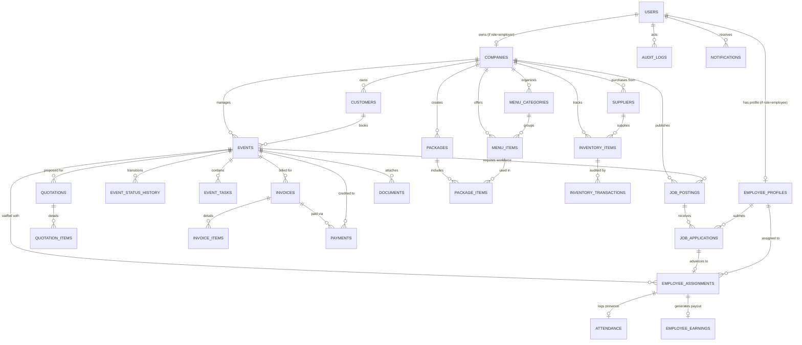

# Phase 3: Database Redesign & Architecture

**Project:** Plated — Multi-Tenant Catering Business Management & Workforce Marketplace  
**Date:** November 19, 2026  
**Document Version:** 1.0.0  
**Target Engine:** PostgreSQL 15+ / SQLAlchemy 2.0  

---

## 1. Architectural Database Principles

1. **Strict 3-Role Identity:** Only `admin`, `employer`, and `employee` exist in `users`.
2. **Decoupled Customers:** Customers are business contacts belonging to an Employer (`company_id`). They do **not** have accounts in `users`.
3. **Multi-Employer Workforce Relationships:** An employee has a single platform-level `employee_profiles` record. Their relationships with employers are formed dynamically through `job_applications`, `employee_assignments`, `attendance`, and `employee_earnings`.
4. **Guaranteed Tenant Isolation:** Every employer-owned table includes `company_id NOT NULL` with an index and foreign key to `companies.id ON DELETE CASCADE`.
5. **Financial Precision:** All currency fields use `NUMERIC(12, 2)` (or `DECIMAL(12, 2)`), never floating-point.
6. **Auditable Timestamps:** Every record tracks `created_at TIMESTAMPTZ DEFAULT CURRENT_TIMESTAMP` and, where appropriate, `updated_at`.

---

## 2. Complete Entity-Relationship Diagram (ERD)



---

## 3. Detailed Table Specifications by Domain

### 3.1 Identity & Authentication Domain

#### `users`
Represents the single platform login account.
```sql
CREATE TYPE user_role AS ENUM ('admin', 'employer', 'employee');
CREATE TYPE user_status AS ENUM ('active', 'suspended', 'pending');

CREATE TABLE users (
    id UUID PRIMARY KEY DEFAULT gen_random_uuid(),
    role user_role NOT NULL,
    email VARCHAR(255) NOT NULL UNIQUE,
    password_hash VARCHAR(255) NOT NULL,
    full_name VARCHAR(150) NOT NULL,
    phone VARCHAR(20) NOT NULL,
    avatar_url TEXT,
    status user_status NOT NULL DEFAULT 'active',
    created_at TIMESTAMPTZ NOT NULL DEFAULT CURRENT_TIMESTAMP,
    updated_at TIMESTAMPTZ NOT NULL DEFAULT CURRENT_TIMESTAMP,
    deleted_at TIMESTAMPTZ
);
CREATE INDEX idx_users_role_status ON users(role, status);
CREATE INDEX idx_users_email ON users(email);
```

#### `employee_profiles`
Platform-level workforce profile for users with `role = 'employee'`.
```sql
CREATE TYPE work_type_pref AS ENUM ('part_time', 'full_time', 'weekend', 'flexible');

CREATE TABLE employee_profiles (
    id UUID PRIMARY KEY DEFAULT gen_random_uuid(),
    user_id UUID NOT NULL UNIQUE REFERENCES users(id) ON DELETE CASCADE,
    date_of_birth DATE,
    gender VARCHAR(30),
    location VARCHAR(150) NOT NULL,
    skills TEXT[] NOT NULL DEFAULT '{}',
    work_experience_years NUMERIC(4, 1) DEFAULT 0.0,
    preferred_work_type work_type_pref NOT NULL DEFAULT 'flexible',
    availability_status VARCHAR(50) DEFAULT 'available',
    preferred_days TEXT[] DEFAULT '{}',
    bio TEXT,
    rating NUMERIC(3, 2) DEFAULT 5.00,
    total_completed_events INT NOT NULL DEFAULT 0,
    created_at TIMESTAMPTZ NOT NULL DEFAULT CURRENT_TIMESTAMP,
    updated_at TIMESTAMPTZ NOT NULL DEFAULT CURRENT_TIMESTAMP
);
CREATE INDEX idx_emp_profile_location ON employee_profiles(location);
CREATE INDEX idx_emp_profile_skills ON employee_profiles USING GIN(skills);
```

---

### 3.2 Business & Company Domain

#### `companies`
Represents an independent catering business owned by an Employer user.
```sql
CREATE TYPE company_status AS ENUM ('pending_approval', 'approved', 'rejected', 'suspended');

CREATE TABLE companies (
    id UUID PRIMARY KEY DEFAULT gen_random_uuid(),
    owner_id UUID NOT NULL REFERENCES users(id) ON DELETE RESTRICT,
    name VARCHAR(200) NOT NULL,
    slug VARCHAR(200) NOT NULL UNIQUE,
    business_type VARCHAR(100) NOT NULL DEFAULT 'Catering Service',
    business_address TEXT NOT NULL,
    gst_number VARCHAR(50),
    description TEXT,
    logo_url TEXT,
    status company_status NOT NULL DEFAULT 'pending_approval',
    rejection_reason TEXT,
    approved_at TIMESTAMPTZ,
    approved_by UUID REFERENCES users(id) ON DELETE SET NULL,
    currency VARCHAR(10) NOT NULL DEFAULT 'INR',
    created_at TIMESTAMPTZ NOT NULL DEFAULT CURRENT_TIMESTAMP,
    updated_at TIMESTAMPTZ NOT NULL DEFAULT CURRENT_TIMESTAMP
);
CREATE INDEX idx_companies_owner ON companies(owner_id);
CREATE INDEX idx_companies_status ON companies(status);
```

---

### 3.3 Customer Management Domain

#### `customers`
Pure business records owned by a company. **NO user account or password**.
```sql
CREATE TABLE customers (
    id UUID PRIMARY KEY DEFAULT gen_random_uuid(),
    company_id UUID NOT NULL REFERENCES companies(id) ON DELETE CASCADE,
    name VARCHAR(150) NOT NULL,
    email VARCHAR(255),
    phone VARCHAR(20) NOT NULL,
    address TEXT,
    notes TEXT,
    created_at TIMESTAMPTZ NOT NULL DEFAULT CURRENT_TIMESTAMP,
    updated_at TIMESTAMPTZ NOT NULL DEFAULT CURRENT_TIMESTAMP,
    deleted_at TIMESTAMPTZ
);
CREATE INDEX idx_customers_company ON customers(company_id);
CREATE INDEX idx_customers_phone ON customers(company_id, phone);
```

---

### 3.4 Event & Operations Domain

#### `events`
Event records managed by a catering company for a specific customer.
```sql
CREATE TYPE event_status AS ENUM (
    'enquiry', 'quotation_sent', 'awaiting_approval', 'advance_pending',
    'confirmed', 'preparation', 'in_progress', 'completed', 'cancelled', 'rejected'
);
CREATE TYPE catering_req AS ENUM ('veg', 'non_veg', 'mixed', 'jain', 'vegan', 'custom');

CREATE TABLE events (
    id UUID PRIMARY KEY DEFAULT gen_random_uuid(),
    company_id UUID NOT NULL REFERENCES companies(id) ON DELETE CASCADE,
    customer_id UUID NOT NULL REFERENCES customers(id) ON DELETE RESTRICT,
    title VARCHAR(200) NOT NULL,
    event_type VARCHAR(100) NOT NULL,
    event_date DATE NOT NULL,
    start_time TIME NOT NULL,
    end_time TIME,
    guest_count INT NOT NULL CHECK (guest_count > 0),
    venue_name VARCHAR(200),
    venue_address TEXT NOT NULL,
    catering_requirement catering_req NOT NULL DEFAULT 'mixed',
    special_instructions TEXT,
    status event_status NOT NULL DEFAULT 'enquiry',
    created_at TIMESTAMPTZ NOT NULL DEFAULT CURRENT_TIMESTAMP,
    updated_at TIMESTAMPTZ NOT NULL DEFAULT CURRENT_TIMESTAMP,
    deleted_at TIMESTAMPTZ
);
CREATE INDEX idx_events_company_date ON events(company_id, event_date);
CREATE INDEX idx_events_status ON events(company_id, status);
```

#### `event_status_history`
Audit trail of event lifecycle changes.
```sql
CREATE TABLE event_status_history (
    id UUID PRIMARY KEY DEFAULT gen_random_uuid(),
    event_id UUID NOT NULL REFERENCES events(id) ON DELETE CASCADE,
    from_status event_status NOT NULL,
    to_status event_status NOT NULL,
    changed_by UUID NOT NULL REFERENCES users(id) ON DELETE RESTRICT,
    note TEXT,
    created_at TIMESTAMPTZ NOT NULL DEFAULT CURRENT_TIMESTAMP
);
CREATE INDEX idx_status_hist_event ON event_status_history(event_id);
```

#### `event_tasks`
Checklist tasks for event operations.
```sql
CREATE TYPE task_phase AS ENUM ('pre_event', 'during_event', 'post_event');
CREATE TYPE task_status AS ENUM ('todo', 'in_progress', 'done');

CREATE TABLE event_tasks (
    id UUID PRIMARY KEY DEFAULT gen_random_uuid(),
    event_id UUID NOT NULL REFERENCES events(id) ON DELETE CASCADE,
    phase task_phase NOT NULL,
    title VARCHAR(255) NOT NULL,
    assigned_to_user_id UUID REFERENCES users(id) ON DELETE SET NULL,
    status task_status NOT NULL DEFAULT 'todo',
    due_at TIMESTAMPTZ,
    completed_at TIMESTAMPTZ,
    notes TEXT
);
CREATE INDEX idx_tasks_event ON event_tasks(event_id);
```

---

### 3.5 Workforce Marketplace Domain

#### `job_postings`
Workforce requirements published by an Employer for an event.
```sql
CREATE TYPE job_posting_status AS ENUM ('open', 'filled', 'cancelled', 'completed');

CREATE TABLE job_postings (
    id UUID PRIMARY KEY DEFAULT gen_random_uuid(),
    company_id UUID NOT NULL REFERENCES companies(id) ON DELETE CASCADE,
    event_id UUID NOT NULL REFERENCES events(id) ON DELETE CASCADE,
    role_title VARCHAR(100) NOT NULL, -- e.g. "Server", "Sous Chef", "Cleaner"
    description TEXT,
    required_count INT NOT NULL DEFAULT 1 CHECK (required_count > 0),
    filled_count INT NOT NULL DEFAULT 0,
    shift_start TIMESTAMPTZ NOT NULL,
    shift_end TIMESTAMPTZ NOT NULL,
    pay_rate NUMERIC(10, 2) NOT NULL, -- e.g. 800.00
    pay_type VARCHAR(20) NOT NULL DEFAULT 'fixed_shift', -- 'fixed_shift' or 'hourly'
    location VARCHAR(200) NOT NULL,
    status job_posting_status NOT NULL DEFAULT 'open',
    created_at TIMESTAMPTZ NOT NULL DEFAULT CURRENT_TIMESTAMP,
    updated_at TIMESTAMPTZ NOT NULL DEFAULT CURRENT_TIMESTAMP
);
CREATE INDEX idx_job_postings_status_date ON job_postings(status, shift_start);
CREATE INDEX idx_job_postings_company ON job_postings(company_id);
```

#### `job_applications`
Applications submitted by Employees for available job postings.
```sql
CREATE TYPE application_status AS ENUM ('applied', 'shortlisted', 'accepted', 'rejected', 'withdrawn');

CREATE TABLE job_applications (
    id UUID PRIMARY KEY DEFAULT gen_random_uuid(),
    job_posting_id UUID NOT NULL REFERENCES job_postings(id) ON DELETE CASCADE,
    employee_id UUID NOT NULL REFERENCES employee_profiles(id) ON DELETE CASCADE,
    cover_note TEXT,
    status application_status NOT NULL DEFAULT 'applied',
    employer_notes TEXT,
    applied_at TIMESTAMPTZ NOT NULL DEFAULT CURRENT_TIMESTAMP,
    reviewed_at TIMESTAMPTZ,
    UNIQUE (job_posting_id, employee_id)
);
CREATE INDEX idx_applications_posting ON job_applications(job_posting_id);
CREATE INDEX idx_applications_employee ON job_applications(employee_id);
```

#### `employee_assignments`
Confirmed shifts connecting an Employee to an Event.
```sql
CREATE TYPE assignment_status AS ENUM ('confirmed', 'in_progress', 'completed', 'cancelled', 'no_show');

CREATE TABLE employee_assignments (
    id UUID PRIMARY KEY DEFAULT gen_random_uuid(),
    company_id UUID NOT NULL REFERENCES companies(id) ON DELETE CASCADE,
    event_id UUID NOT NULL REFERENCES events(id) ON DELETE CASCADE,
    job_posting_id UUID REFERENCES job_postings(id) ON DELETE SET NULL,
    employee_id UUID NOT NULL REFERENCES employee_profiles(id) ON DELETE RESTRICT,
    event_role VARCHAR(100) NOT NULL,
    shift_start TIMESTAMPTZ NOT NULL,
    shift_end TIMESTAMPTZ NOT NULL,
    agreed_pay NUMERIC(10, 2) NOT NULL,
    status assignment_status NOT NULL DEFAULT 'confirmed',
    notes TEXT,
    created_at TIMESTAMPTZ NOT NULL DEFAULT CURRENT_TIMESTAMP,
    UNIQUE (event_id, employee_id)
);
CREATE INDEX idx_assignments_event ON employee_assignments(event_id);
CREATE INDEX idx_assignments_employee ON employee_assignments(employee_id);
```

#### `attendance`
Digital check-in / check-out records for assigned employees.
```sql
CREATE TYPE attendance_status AS ENUM ('present', 'late', 'absent', 'half_day');

CREATE TABLE attendance (
    id UUID PRIMARY KEY DEFAULT gen_random_uuid(),
    assignment_id UUID NOT NULL UNIQUE REFERENCES employee_assignments(id) ON DELETE CASCADE,
    check_in TIMESTAMPTZ,
    check_out TIMESTAMPTZ,
    hours_worked NUMERIC(5, 2) DEFAULT 0.00,
    status attendance_status NOT NULL DEFAULT 'present',
    verified_by_employer BOOLEAN NOT NULL DEFAULT FALSE,
    notes TEXT
);
CREATE INDEX idx_attendance_assignment ON attendance(assignment_id);
```

#### `employee_earnings`
Event-wise earnings and payout tracking for employees.
```sql
CREATE TYPE payout_status AS ENUM ('pending', 'approved', 'paid', 'disputed');

CREATE TABLE employee_earnings (
    id UUID PRIMARY KEY DEFAULT gen_random_uuid(),
    assignment_id UUID NOT NULL UNIQUE REFERENCES employee_assignments(id) ON DELETE RESTRICT,
    employee_id UUID NOT NULL REFERENCES employee_profiles(id) ON DELETE RESTRICT,
    company_id UUID NOT NULL REFERENCES companies(id) ON DELETE RESTRICT,
    amount NUMERIC(10, 2) NOT NULL,
    status payout_status NOT NULL DEFAULT 'pending',
    payment_reference VARCHAR(100),
    paid_at TIMESTAMPTZ,
    created_at TIMESTAMPTZ NOT NULL DEFAULT CURRENT_TIMESTAMP
);
CREATE INDEX idx_earnings_employee ON employee_earnings(employee_id, status);
CREATE INDEX idx_earnings_company ON employee_earnings(company_id, status);
```

---

### 3.6 Commercial & Financial Domain

#### `quotations` & `quotation_items`
```sql
CREATE TYPE quote_status AS ENUM ('draft', 'sent', 'accepted', 'rejected', 'expired');

CREATE TABLE quotations (
    id UUID PRIMARY KEY DEFAULT gen_random_uuid(),
    company_id UUID NOT NULL REFERENCES companies(id) ON DELETE CASCADE,
    event_id UUID NOT NULL REFERENCES events(id) ON DELETE CASCADE,
    quote_number VARCHAR(50) NOT NULL,
    status quote_status NOT NULL DEFAULT 'draft',
    subtotal NUMERIC(12, 2) NOT NULL DEFAULT 0.00,
    discount NUMERIC(12, 2) NOT NULL DEFAULT 0.00,
    tax_percent NUMERIC(5, 2) NOT NULL DEFAULT 5.00,
    delivery_charge NUMERIC(12, 2) NOT NULL DEFAULT 0.00,
    advance_amount NUMERIC(12, 2) NOT NULL DEFAULT 0.00,
    total NUMERIC(12, 2) NOT NULL DEFAULT 0.00,
    valid_until DATE,
    sent_at TIMESTAMPTZ,
    responded_at TIMESTAMPTZ,
    created_at TIMESTAMPTZ NOT NULL DEFAULT CURRENT_TIMESTAMP
);

CREATE TABLE quotation_items (
    id UUID PRIMARY KEY DEFAULT gen_random_uuid(),
    quotation_id UUID NOT NULL REFERENCES quotations(id) ON DELETE CASCADE,
    package_id UUID,
    description VARCHAR(255) NOT NULL,
    quantity INT NOT NULL DEFAULT 1,
    unit_price NUMERIC(12, 2) NOT NULL,
    line_total NUMERIC(12, 2) NOT NULL
);
```

#### `invoices`, `invoice_items` & `payments`
```sql
CREATE TYPE invoice_status AS ENUM ('draft', 'sent', 'partially_paid', 'paid', 'cancelled', 'overdue');
CREATE TYPE payment_status AS ENUM ('pending', 'paid', 'failed', 'refunded');
CREATE TYPE payment_type AS ENUM ('advance', 'partial', 'balance', 'refund');

CREATE TABLE invoices (
    id UUID PRIMARY KEY DEFAULT gen_random_uuid(),
    company_id UUID NOT NULL REFERENCES companies(id) ON DELETE CASCADE,
    event_id UUID NOT NULL REFERENCES events(id) ON DELETE CASCADE,
    invoice_number VARCHAR(50) NOT NULL,
    status invoice_status NOT NULL DEFAULT 'draft',
    subtotal NUMERIC(12, 2) NOT NULL DEFAULT 0.00,
    tax NUMERIC(12, 2) NOT NULL DEFAULT 0.00,
    discount NUMERIC(12, 2) NOT NULL DEFAULT 0.00,
    total NUMERIC(12, 2) NOT NULL DEFAULT 0.00,
    due_date DATE,
    created_at TIMESTAMPTZ NOT NULL DEFAULT CURRENT_TIMESTAMP
);

CREATE TABLE invoice_items (
    id UUID PRIMARY KEY DEFAULT gen_random_uuid(),
    invoice_id UUID NOT NULL REFERENCES invoices(id) ON DELETE CASCADE,
    description VARCHAR(255) NOT NULL,
    quantity INT NOT NULL DEFAULT 1,
    rate NUMERIC(12, 2) NOT NULL,
    amount NUMERIC(12, 2) NOT NULL
);

CREATE TABLE payments (
    id UUID PRIMARY KEY DEFAULT gen_random_uuid(),
    company_id UUID NOT NULL REFERENCES companies(id) ON DELETE CASCADE,
    event_id UUID NOT NULL REFERENCES events(id) ON DELETE CASCADE,
    invoice_id UUID REFERENCES invoices(id) ON DELETE SET NULL,
    amount NUMERIC(12, 2) NOT NULL,
    type payment_type NOT NULL DEFAULT 'advance',
    status payment_status NOT NULL DEFAULT 'paid',
    provider VARCHAR(50) DEFAULT 'manual',
    provider_ref VARCHAR(100),
    paid_at TIMESTAMPTZ NOT NULL DEFAULT CURRENT_TIMESTAMP,
    created_at TIMESTAMPTZ NOT NULL DEFAULT CURRENT_TIMESTAMP
);
```

---

### 3.7 Menus, Packages & Inventory Domain

- `menu_categories`: Grouping for menu items (appetizers, main course, desserts).
- `menu_items`: Individual dishes with veg/non-veg tags, allergens, price.
- `packages`: Combo catering offerings (e.g., "Royal Buffet", "Silver Package") with per-guest pricing.
- `package_items`: Join table linking `packages` to `menu_items`.
- `inventory_items`: Raw materials and catering equipment stock quantities.
- `inventory_transactions`: Log of additions, event consumption, and wastage.
- `suppliers`: Vendor contacts supplying inventory materials.

---

### 3.8 Platform Communication & Governance Domain

- `documents`: File uploads linked to company/event with visibility scoping.
- `notifications`: User-specific in-app alerts (for job applications, shift assignments, approvals).
- `audit_logs`: Immutable trail of actions performed by Admin and Employers.

