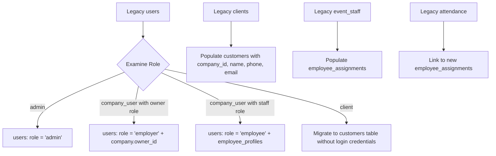

# Phase 4: Database Migration & Transformation Plan

**Project:** Plated — Multi-Tenant Catering Business Management & Workforce Marketplace  
**Date:** November 19, 2026  
**Document Version:** 1.0.0  
**Target Alembic Migration Revision:** `v2_three_role_workforce_restructure`  

---

## 1. Complete Classification of All 32 Existing Tables

Every table currently present in the PostgreSQL database (`plated_v2_db`) has been audited and classified:

| # | Table Name | Action | Reason & Transformation Details |
|---|---|:---:|---|
| 1 | `alembic_version` | **KEEP** | Standard Alembic version tracker. Updated automatically during migration. |
| 2 | `users` | **MODIFY** | • Alter `global_role` enum to `user_role` (`admin`, `employer`, `employee`).<br>• Migrate `company_user` owners to `employer`.<br>• Migrate `company_user` staff to `employee`.<br>• Convert existing `client` users into pure `customers` records and remove client credentials. |
| 3 | `companies` | **MODIFY** | • Add `owner_id UUID NOT NULL REFERENCES users(id)`.<br>• Expand `company_status` enum to include `pending_approval`, `approved`, `rejected`, `suspended`.<br>• Add `business_type`, `business_address`, `description`, `rejection_reason`. |
| 4 | `company_members` | **REPLACE** | **Obsolete in 3-role model.** In the legacy model, this table locked employees to one company and stored internal hierarchy (`owner`, `manager`, `staff`). Replaced by platform-level `employee_profiles` + many-to-many `employee_assignments`. |
| 5 | `permissions` | **REMOVE** | **Obsolete.** Legacy 49-permission keys matrix for internal company roles. Replaced by clean 3-role RBAC dependencies. |
| 6 | `role_permissions` | **REMOVE** | **Obsolete.** Join table for legacy permission matrix. |
| 7 | `member_permission_overrides` | **REMOVE** | **Obsolete.** Granular overrides table for legacy company members. |
| 8 | `clients` | **REPLACE / MERGE** | **Transform into `customers`:** Drop `user_id` foreign key. Retain customer business details (`name`, `phone`, `email`, `address`, `notes`, `company_id`). |
| 9 | `events` | **MODIFY** | • Rename/point FK `client_id` to `customer_id` (`customers.id`).<br>• Ensure `company_id` indexing and tenant isolation. |
| 10 | `event_status_history` | **KEEP** | Retain lifecycle tracking; ensures `changed_by` references valid `users.id`. |
| 11 | `event_staff` | **REPLACE** | Replace with `employee_assignments` which links directly to `employee_profiles.id` and supports agreed shift pay. |
| 12 | `event_tasks` | **MODIFY** | Update `assigned_to` from `company_members.id` to `users.id` (or assigned employee). |
| 13 | `attendance` | **MODIFY** | Update FK from `company_member_id` to `assignment_id` (`employee_assignments.id`). |
| 14 | `quotations` | **KEEP** | Quotations remain employer-scoped event proposals. |
| 15 | `quotation_items` | **KEEP** | Itemized quote details retained. |
| 16 | `invoices` | **KEEP** | Event billing records retained. |
| 17 | `invoice_items` | **KEEP** | Itemized invoice details retained. |
| 18 | `payments` | **KEEP** | Financial ledger records retained. |
| 19 | `menu_categories` | **KEEP** | Employer-owned food categories retained. |
| 20 | `menu_items` | **KEEP** | Employer-owned dishes and recipes retained. |
| 21 | `packages` | **KEEP** | Catering combo packages retained. |
| 22 | `package_items` | **KEEP** | Package to menu items mapping retained. |
| 23 | `inventory_items` | **KEEP** | Stock tracking retained. |
| 24 | `inventory_transactions` | **KEEP** | Stock ledger retained. |
| 25 | `suppliers` | **KEEP** | Vendor contacts retained. |
| 26 | `documents` | **MODIFY** | Keep schema; refactor API endpoint to require authenticated downloads instead of static mount. |
| 27 | `messages` | **MODIFY** | Retain for event communications; ensure messages link `sender_id` (`users.id`). |
| 28 | `notifications` | **KEEP** | Multi-role user notifications retained. |
| 29 | `feedback` | **KEEP** | Event review records retained. |
| 30 | `audit_logs` | **KEEP** | Platform and employer audit log retained. |
| 31 | `settings` | **KEEP** | Company configuration key-values retained. |
| 32 | `subscriptions` | **KEEP** | SaaS plan status retained. |

---

## 2. New Tables to Introduce

1. **`employee_profiles`:**
   Stores workforce data for `role = 'employee'` (DOB, gender, location, skills array, work experience, preferred work type, availability, bio, rating).
2. **`customers`:**
   Pure business contacts owned by catering companies (migrated cleanly from legacy `clients`).
3. **`job_postings`:**
   Workforce requirements published by employers for specific events (required role, headcount, shift hours, pay rate).
4. **`job_applications`:**
   Marketplace applications from employees for job postings.
5. **`employee_assignments`:**
   Confirmed shift contracts between an event and an employee.
6. **`employee_earnings`:**
   Payout ledger tracking event-wise earnings per shift for each employee.

---

## 3. Data Migration & Preservation Strategy

Existing seed/demo records must be transformed non-destructively:



### 3.1 Step-by-Step Data Transformation Logic
1. **Companies & Owners:**
   - For each company in `companies`, find its `owner` member in `company_members`.
   - Update `companies.owner_id = owner.user_id`.
   - Set `companies.status = 'approved'`.
   - Update the owner's `users.role = 'employer'`.
2. **Employees:**
   - For all `company_user` members with `employment_role IN ('manager', 'staff')`:
   - Update `users.role = 'employee'`.
   - Create a corresponding `employee_profiles` record for each user with their name, phone, and default skills.
3. **Clients to Customers:**
   - Copy all records from `clients` to `customers` (preserving `id`, `company_id`, `name`, `email`, `phone`, `notes`).
   - Re-point `events.client_id` to `events.customer_id`.
   - Delete legacy client accounts from `users` (or archive them) since customers do not log in.
4. **Staff Assignments & Attendance:**
   - Migrate `event_staff` rows to `employee_assignments` by mapping `company_member.user_id` to `employee_profiles.id`.
   - Migrate `attendance` rows to reference the new `employee_assignments.id`.

---

## 4. Execution Order & Foreign Key Dependency Chain

To ensure zero constraint violations, migrations must execute in this exact sequence:

```
Step 1:  Create new ENUM types (user_role, company_status_new, job_posting_status, etc.)
Step 2:  Create new tables: customers, employee_profiles, job_postings, job_applications, employee_assignments, employee_earnings
Step 3:  Execute Data Migration Script:
         a. Link companies.owner_id
         b. Update users.role to 'admin', 'employer', 'employee'
         c. Populate employee_profiles
         d. Copy clients -> customers
         e. Copy event_staff -> employee_assignments
         f. Re-link attendance to employee_assignments
         g. Re-link events.customer_id to customers.id
Step 4:  Drop legacy foreign keys:
         a. Drop FK clients_user_id_fkey
         b. Drop FK events_client_id_fkey
         c. Drop FK attendance_company_member_id_fkey
         d. Drop FK event_staff_company_member_id_fkey
Step 5:  Drop obsolete legacy tables:
         a. DROP TABLE member_permission_overrides
         b. DROP TABLE role_permissions
         c. DROP TABLE permissions
         d. DROP TABLE company_members
         e. DROP TABLE event_staff
         f. DROP TABLE clients
Step 6:  Enforce final NOT NULL and UNIQUE constraints on new schema
```

---

## 5. Backup & Verification Strategy

### 5.1 Pre-Migration Snapshot (Required Before Execution)
Before applying the Alembic migration or altering tables, a physical SQL dump will be taken:
```bash
pg_dump -U postgres -h /var/run/postgresql -d plated_v2_db -F c -b -v -f /home/joes_17/Documents/plated-project-final/backend/backup_plated_pre_migration.dump
```

### 5.2 Verification Checklist
- [ ] Confirm row counts: All historical events, invoices, and payments remain intact.
- [ ] Verify `users` table contains strictly `role IN ('admin', 'employer', 'employee')`.
- [ ] Verify every `company` has a valid `owner_id`.
- [ ] Verify every `employee` has an `employee_profiles` entry.
- [ ] Verify all `events` reference valid `customers.id`.
- [ ] Verify Alembic migration can run up (`upgrade head`) and down (`downgrade -1`) cleanly in test environment.

