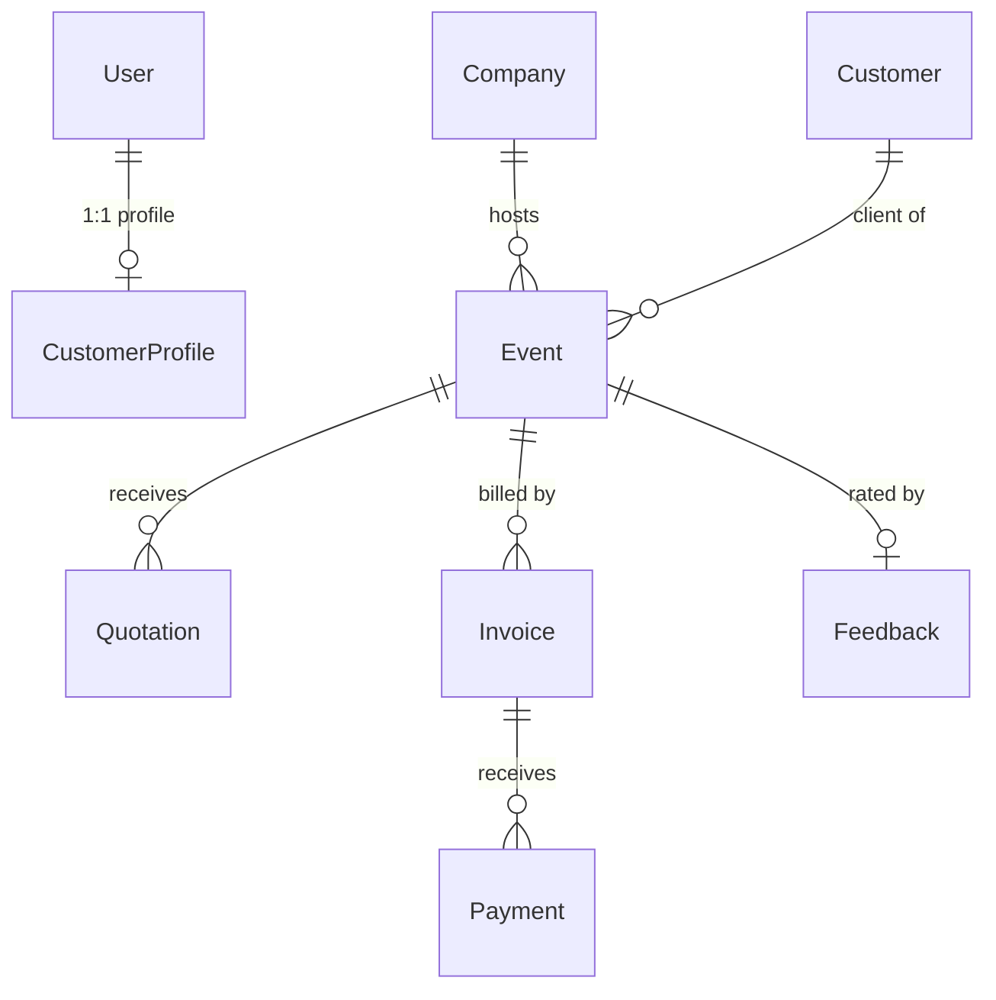
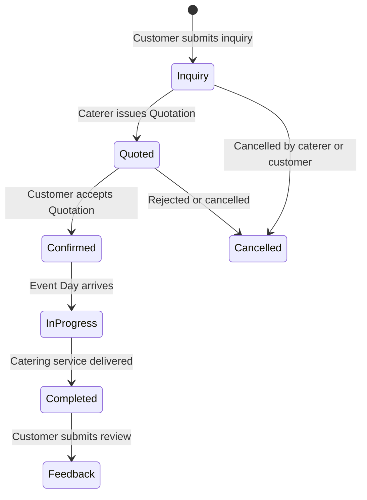

# PLATED – Customer Role Architecture Specification
**Document Version:** 1.0.0  
**Status:** Implemented & Verified  
**Target Platform:** PLATED (Hybrid SaaS + Marketplace)

---

## 1. Domain Entities & Database Architecture

### Table Relationships:
1. `users` (`role = 'customer'`) $\leftrightarrow$ `customer_profiles` (`user_id` FK).
2. `companies` (catering businesses approved by Admin) $\leftrightarrow$ `events` (`company_id` FK).
3. `customers` (CRM contact record for caterer) $\leftrightarrow$ `events` (`customer_id` FK).
4. `events` $\leftrightarrow$ `quotations` (`event_id` FK).
5. `events` $\leftrightarrow$ `invoices` (`event_id` FK).
6. `invoices` $\leftrightarrow$ `payments` (`invoice_id` FK).
7. `events` $\leftrightarrow$ `feedback` (`event_id` FK).

---

## 2. API Endpoints Specification (`/api/customer`)

| Method | Endpoint | Description | Auth Requirement |
|---|---|---|---|
| `GET` | `/api/customer/profile` | View customer profile and default preferences | `require_customer` |
| `PATCH` | `/api/customer/profile` | Update address, city, preferred cuisines | `require_customer` |
| `GET` | `/api/customer/caterers` | Directory of approved catering companies | `require_customer` / Public |
| `GET` | `/api/customer/caterers/{id}` | Public profile, menus, and packages | `require_customer` / Public |
| `POST` | `/api/customer/inquiries` | Submit catering inquiry (spawns Event) | `require_customer` |
| `GET` | `/api/customer/events` | List all catering bookings across all caterers | `require_customer` |
| `GET` | `/api/customer/events/{id}` | Detailed event specifications and timeline | `require_customer` |
| `GET` | `/api/customer/events/{id}/quotations` | List quotations for an event | `require_customer` |
| `POST` | `/api/customer/events/{id}/quotations/{quote_id}/accept` | Accept quote $\to$ confirms event booking | `require_customer` |
| `GET` | `/api/customer/events/{id}/invoices` | List invoices and outstanding balance | `require_customer` |
| `POST` | `/api/customer/invoices/{invoice_id}/pay` | Record deposit or milestone payment | `require_customer` |
| `POST` | `/api/customer/events/{id}/feedback` | Submit caterer rating & review | `require_customer` |

---

## 3. Booking & Quotation State Machine

