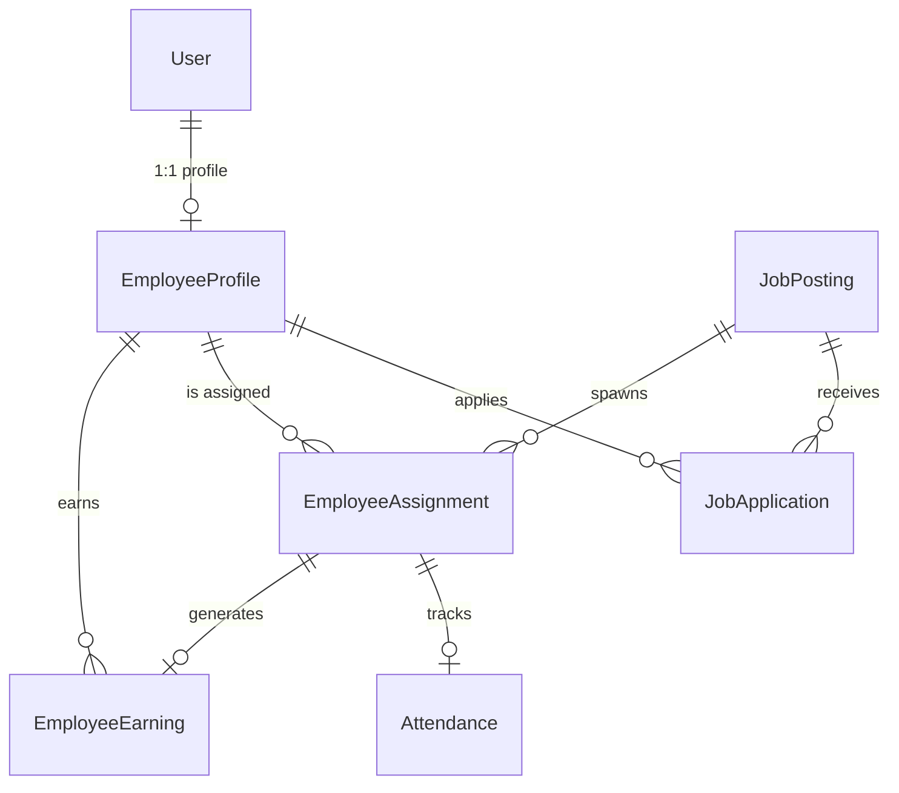

# PLATED – Employee Role Architecture Specification
**Document Version:** 1.0.0  
**Status:** Implemented & Verified  
**Target Platform:** PLATED (Hybrid SaaS + Marketplace)

---

## 1. Domain Entities & Database Model

### Table Relationships:
1. `users` (`role = 'employee'`) $\leftrightarrow$ `employee_profiles` (`user_id` FK).
2. `job_postings` $\leftrightarrow$ `job_applications` (`employee_id` FK to `employee_profiles.id`).
3. `employee_assignments` (`employee_id` FK to `employee_profiles.id`, `event_id` FK to `events.id`).
4. `attendance` (`assignment_id` FK to `employee_assignments.id`).
5. `employee_earnings` (`assignment_id` FK, `employee_id` FK, `company_id` FK).

---

## 2. API Endpoints Specification

### Employee Marketplace Router (`/api/employee`)

| Method | Endpoint | Description | Auth Requirement |
|---|---|---|---|
| `GET` | `/api/employee/profile` | Fetch employee workforce profile & stats | `require_employee` |
| `PATCH` | `/api/employee/profile` | Update skills, bio, rate, availability | `require_employee` |
| `PUT` | `/api/employee/profile` | Alias for full profile update | `require_employee` |
| `GET` | `/api/employee/jobs` | Search & filter open shifts in marketplace | `require_employee` |
| `GET` | `/api/employee/jobs/{id}` | View detailed shift requirements | `require_employee` |
| `POST` | `/api/employee/jobs/{id}/apply` | Apply for open shift with cover note | `require_employee` |
| `GET` | `/api/employee/applications` | List submitted shift applications & statuses | `require_employee` |
| `DELETE` | `/api/employee/applications/{id}`| Withdraw a pending shift application | `require_employee` |
| `GET` | `/api/employee/schedule` | View confirmed shift schedule & caterers | `require_employee` |
| `POST` | `/api/employee/attendance/check` | Digital clock-in / clock-out | `require_employee` |
| `POST` | `/api/employee/assignments/{id}/check-in` | Direct clock-in endpoint | `require_employee` |
| `POST` | `/api/employee/assignments/{id}/check-out` | Direct clock-out endpoint | `require_employee` |
| `GET` | `/api/employee/attendance` | Attendance records & verified hours | `require_employee` |
| `GET` | `/api/employee/earnings` | Consolidated earnings summary & payouts | `require_employee` |

---

## 3. Payout Calculation Lifecycle

1. **Shift Completed:** Employee triggers check-out or Employer logs hours worked.
2. **Gross Amount Computation:** $\text{Gross} = \text{hours\_worked} \times \text{agreed\_pay\_rate}$.
3. **Ledger Record:** `employee_earnings` record created with `status = 'pending'`.
4. **Approval & Settlement:** Catering employer or Admin approves payout, setting `status = 'paid'` and attaching `payment_reference`.
5. **Real-time Metrics:** `EmployeeEarningsSummaryOut` aggregates `total_earnings`, `paid_out`, and `pending_payout`.

